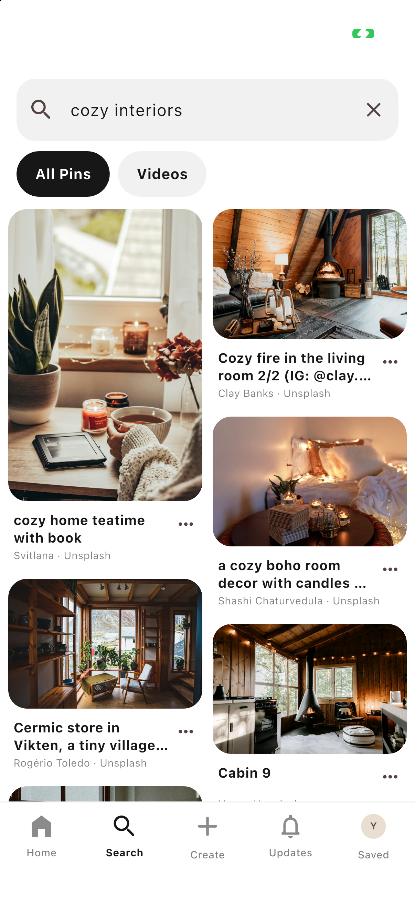

# Galaxy Pinterest

A Pinterest-inspired **Flutter mobile application** built for the Galaxy.ai internship assignment. It uses every required package and separates presentation, domain, and data concerns. Live photos come from Unsplash, the alternative explicitly permitted in the assignment. Pexels integration is also included.

## Run

Built and tested with Flutter **3.41.6 / Dart 3.11.4**, Android API 24+, and iOS 15+.

```sh
flutter pub get
# Bundled, offline-friendly photo demo; no account or API keys required.
flutter run
# Live Unsplash discovery and real Clerk authentication (this machine is configured).
flutter run --dart-define-from-file=config/local.json
```

For a fresh checkout, copy `config/example.json` to `config/local.json`, then populate the keys you want to use. Empty keys select guest/demo mode. `UNSPLASH_ACCESS_KEY` takes precedence for photos; `PEXELS_API_KEY` enables Pexels photos when Unsplash is absent and video discovery when present. `CLERK_PUBLISHABLE_KEY` enables Clerk on Android/iOS. **Never add a Clerk secret key or Unsplash secret key to the Flutter app.** The local configuration is ignored by Git.

```sh
flutter devices
flutter run -d <device-id> --dart-define-from-file=config/local.json
# Optional web UI preview: Clerk's required Flutter SDK is native-only.
flutter run -d chrome
```

## Preview

<p>
  
  
</p>

A 5:26 silent iOS simulator walkthrough and the signed APK are provided in the local `artifacts/` folder (excluded from Git).

## Experience

- Two-column masonry feed on phones; adaptive columns on larger screens.
- Live discovery, topic feeds, infinite pagination, duplicate suppression, pull-to-refresh, shimmer placeholders, image caching, retry states, and cached first-page fallback.
- Independent tab/category scroll positions using GoRouter stateful branches, keep-alive pages, and PageStorage.
- Hero image transitions, press animations, selection haptics, animated likes, and native bottom sheets.
- Debounced photo search, topic discovery, persistent recent searches, clear history, and empty states.
- Pin details, source/photographer attribution links, related ideas, likes, sharing, image export, hide/reset, and board selection.
- Create/edit/delete boards, private-board labels, remove Pins, and a saved/created collection.
- Create image Pins with the native photo picker, validated title/link, description, board selection, and durable local image bytes.
- Profile editing, appearance settings, local activity history, privacy information, and Clerk sign-up/sign-in/sign-out.
- Guest and signed-in libraries are isolated by Clerk user ID. Guest data is retained when you sign in and returns when you sign out.

Collections are **local to the device**. Clerk supplies identity and session management, not a database for board synchronization. This project does not claim to implement a cloud social network, messaging, followers, or comments. Native sharing opens the OS share sheet; image download/export opens the OS file/share destination picker.

## Architecture

```text
lib/
  core/            Configuration, theme, network/cache/file services, common UI
  domain/          Immutable entities, repository contract, discovery use case
  data/            Demo, Unsplash, Pexels data sources and repository implementation
  presentation/
    providers/     Dependency injection, feed and library controllers
    screens/       Screens and form coordination
    widgets/       Reusable masonry, image, Pin, and board widgets
  app.dart         GoRouter, stateful navigation shell, Clerk/session bridge
  main.dart        Bootstrap and cache dependency injection
```

The domain has no Flutter imports. Riverpod injects repository/services and owns state. `DiscoverPins` is the discovery use case; `SavePin` owns idempotent board-membership rules. Collection persistence is injected through the domain `LibraryRepository` contract. `FeedController` coordinates requests with generation guards to discard stale results; pagination failures preserve existing content and can be retried. `LibraryController` serializes mutations and persists successfully before publishing new state, preventing lost concurrent updates. First-page metadata caches expire after 15 minutes and are bounded to 16 query entries. Images use `cached_network_image`, with bounded decode sizes and aspect-ratio reservation to avoid layout jumps.

See [architecture](docs/ARCHITECTURE.md), [assignment checklist](docs/ASSIGNMENT.md), and [walkthrough guide](docs/WALKTHROUGH.md).

## Required packages

| Requirement | Package | Usage |
| --- | --- | --- |
| State management | `flutter_riverpod` | DI, scoped libraries, feed/library state |
| Navigation | `go_router` | Indexed stateful shell, deep Pin and board routes |
| Networking | `dio` | Authenticated Unsplash/Pexels API and media requests |
| Image caching | `cached_network_image` | Network images, decode sizing, failure placeholders |
| Loading | `shimmer` | Feed skeleton and image placeholders |
| Masonry grid | `flutter_staggered_grid_view` | Lazy sliver masonry layout |
| Authentication | `clerk_flutter` | Real native authentication and session lifecycle |

## Verify

```sh
flutter analyze
flutter test
# Uses only config/local.json. Prints service status, never credentials.
python3 scripts/check_services.py
```

Tests cover full Pin-save navigation, empty search, durable/idempotent saves, account isolation, concurrent mutations, multi-board membership, deletion behavior, corrupt cache recovery, search history bounds, stale-request suppression, pagination deduplication, and retry preservation.

## Build deliverables

```sh
# Optional, creates an ignored assignment-only release signing identity.
python3 scripts/setup_signing.py
flutter build apk --release --dart-define-from-file=config/local.json
# Output: build/app/outputs/flutter-apk/app-release.apk

# iOS simulator: boot a simulator, then run with its exact device ID.
flutter run -d <ios-simulator-id> --dart-define-from-file=config/local.json
# iOS device archive requires your Apple development team and signing setup.
flutter build ios --release --no-codesign --dart-define-from-file=config/local.json
```

The submission APK is a release-mode build signed with a locally generated assignment certificate. The keystore/password file stay on this machine and must be backed up privately if publishing updates. CI intentionally builds a keyless demo using a development signing identity; configure your own release signing before store distribution.

On the installed Xcode 27 toolchain, use an exact simulator destination (`flutter run -d ...`). Generic universal-simulator builds can encounter a Flutter 3.41/Xcode architecture detection mismatch. Do not run Flutter tests and platform builds concurrently in the same checkout, because plugin registrant files are shared.

## API setup and limits

The configured free Unsplash application is **Galaxy Pinterest**, in demo mode (50 API requests/hour). Pexels was not issuing new API keys when this project was configured, so the assignment-approved Unsplash alternative is used. First-page caching and 650 ms search debounce reduce requests; provider errors show useful retry states.

Unsplash images use returned CDN URLs, with photographer and Unsplash attribution and links. Saving/exporting a live photo registers its download endpoint. Only public photo-read access is used. Photo API access keys are extractable from a compiled client; use a rate-limited server proxy for a public production deployment. **Do not publish the local live-service APK or its API configuration in a public repository.** Share the live APK privately with evaluators or build a keyless demo for public releases.

Clerk is configured as a development application with email authentication. The required `clerk_flutter` package is a community-maintained beta. Clerk SDK telemetry is disabled. Password/email verification is handled by Clerk; no app passwords are stored by this project. Native sign-in needs internet access. Optional web output is a guest UI preview.

## Submission

The original assignment asks for a public GitHub repository, a release APK, and a 5–10 minute iOS walkthrough. Keep source/config examples in Git; exclude keys, signing files, build outputs, and local user data. See `docs/ASSIGNMENT.md` for the requirement mapping and `docs/WALKTHROUGH.md` for a five-minute demonstration script.

Educational project, not affiliated with Pinterest. Photo rights belong to their respective photographers; bundled demo photos link to their original Pexels pages. Dependencies retain their own licenses.
